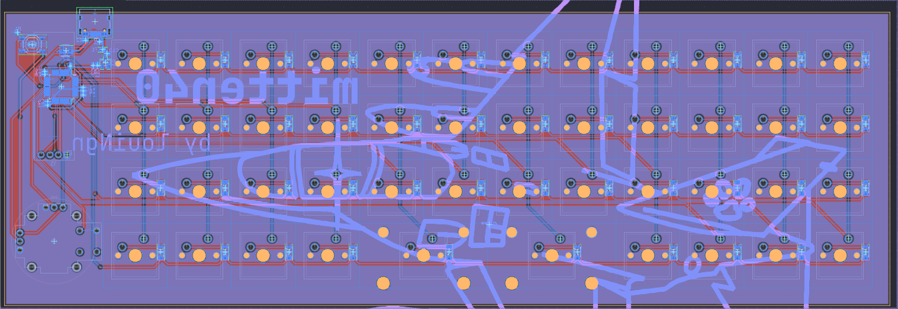

# mitten40 
## An ortholinear keyboard with a joystick!

The mitten40 is a 46-key, split-spacebar ortholinear keyboard with a customizable OLED screen and joystick.

# key layout

# firmware
The mitten40 utilizes [QMK firmware](https://qmk.fm/) 

Expect coming changes to C scripts seen in the project, its untested currently!

# case

The mitten40 utilizes a 3D printed gasket-mount case secured with M3 heat set inserts and screws.

# build guide (TO BE UPDATED ONCE I GET MY HANDS ON IT)
[View bills of materials here!](BOMs)

PCB SMD components: Options include hotplate/hot air soldering at home, assembly by a third-party service (JLCPCB is my choice), or, if you're cracked enough, hand soldering with a soldering iron.

Before continuing, flash QMK firmware on to the keyboard, and use a pair of conductive tweezers to test the PCB for any issues (firmware error, damaged PCB, unresponsive through-hole pins, etc...), and resolve any issues that arises (which may include reordering your PCB).

PCB through-hole components: With sufficient flux and a soldering iron, solder Cherry-MX compatible switches, joystick, and OLED screen through their respective through-hole components. Optionally, solder a 4-pin socket through the OLED screen footprint if you want easily-swappable screens/afraid of damaging the screen when soldering directly.
#### IMPORTANT: REMEMBER TO MOUNT SWITCHES ON TO THE PLATE BEFORE SOLDERING, AND PLACE COMPONENTS UNDERNEATH THE PLATE TO KEEP THEM IN PLACE DURING SOLDERING AND MOUNTING.

Case assembly:
+ Assuming you've mounted the switches on to the plate and the PCB before soldering, begin attaching foam gaskets you've bought on to the top of the small "fins" extruded around the plate on both sides, trimming excess material where necessary to ensure a tight fit.
+ Use your soldering iron, and optionally a heat-set insert press for more precision, push the M3 heat set inserts into their respective holes in the top housing of the keyboard case, before letting everything cool down. (NOTE: DO NOT PRESS TOO FAR AS IT MIGHT GO THROUGH THE ENTIRE HOUSING)
+ Sandwich the PCB-plate between the top and the bottom housing, ensuring the entire contraption is sitting flush in between them.
+ Use M3 screws you've bought to bolt everything together from the bottom housing, tightening it too hard may lead to the housings cracking so please avoid that.
+ Finally, attach the anti-slip nubs on to the bottom of the case in their respective nub holes, and wait for it to set into the PCB before using.

